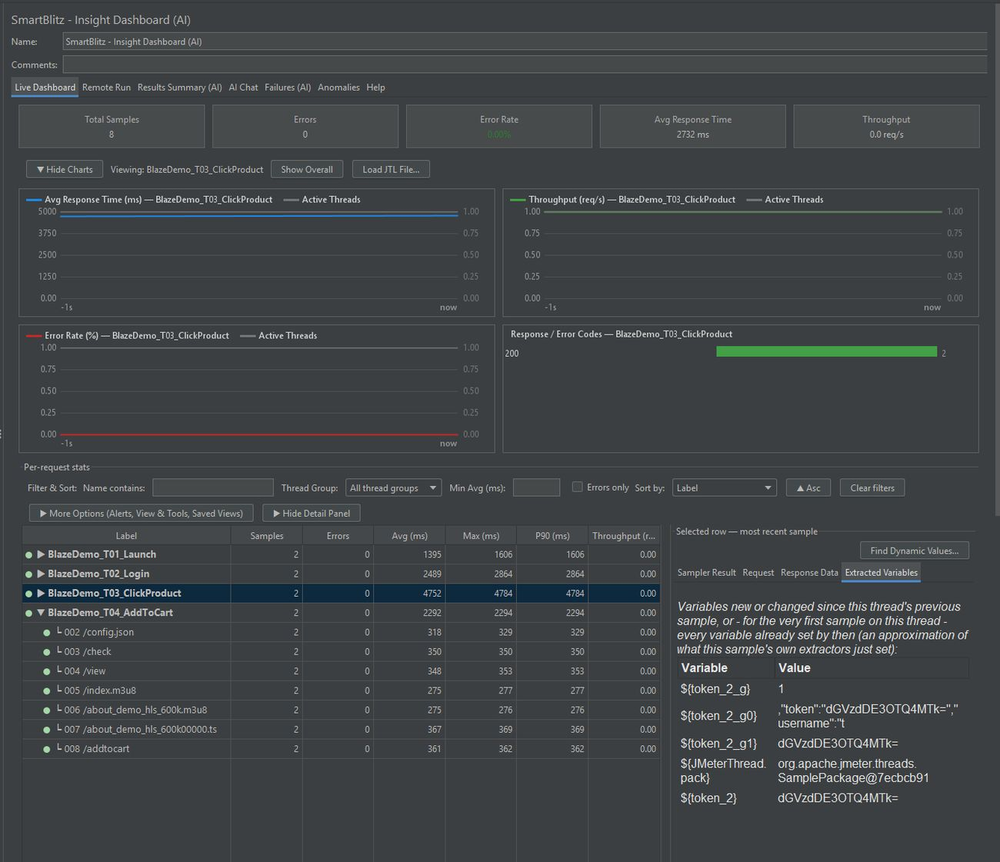
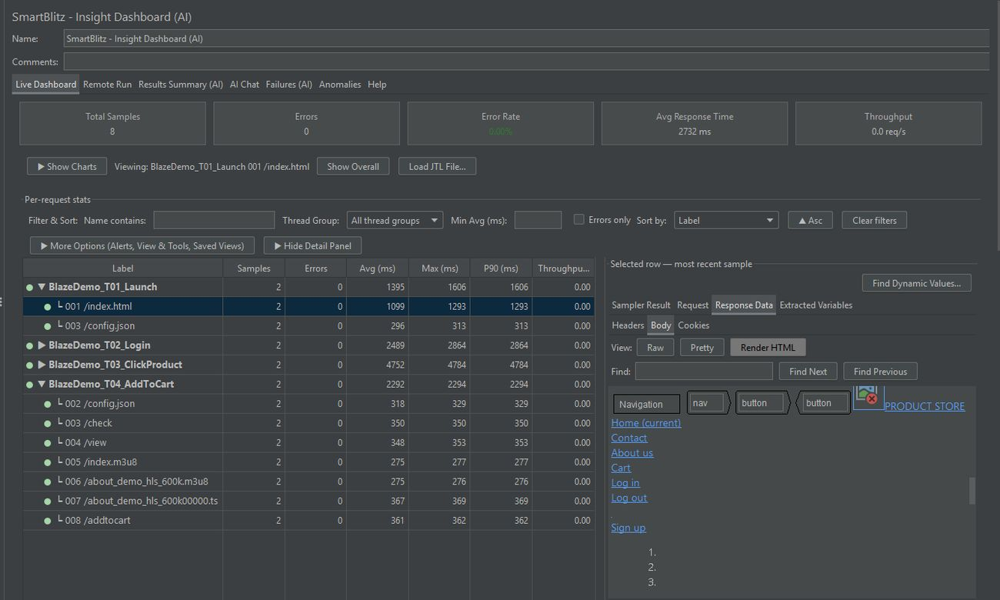
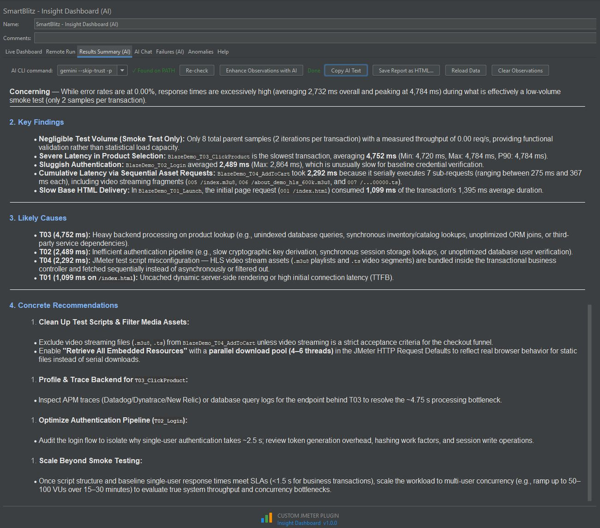
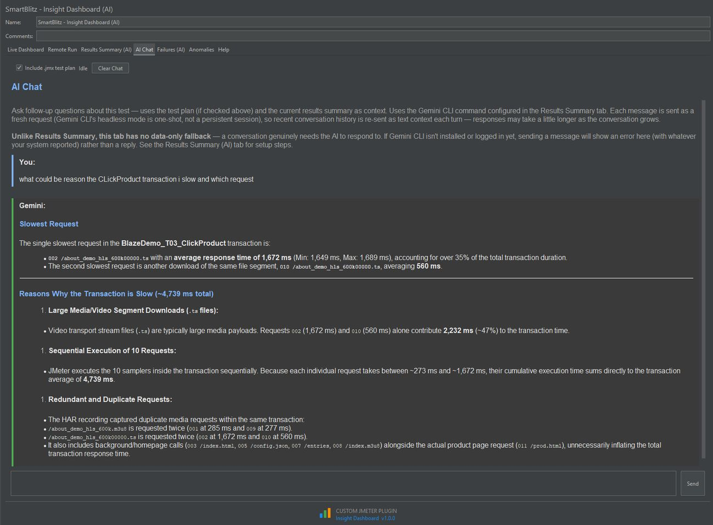
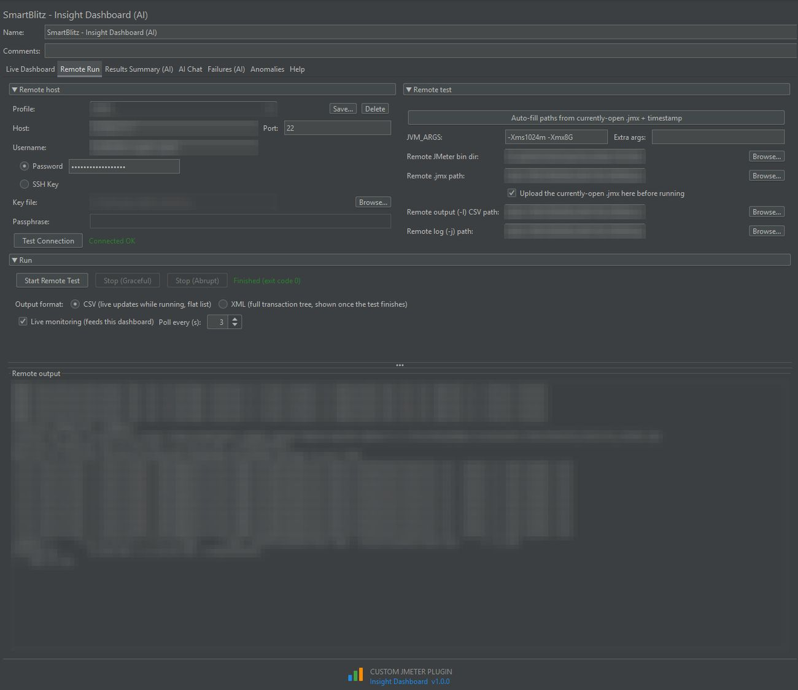

# SmartBlitz Insight Dashboard for JMeter


A real-time, collapsible per-transaction results listener for JMeter, with optional AI summaries and chat.

Part of the **SmartBlitz AI for JMeter** toolkit. Overview and screenshots: https://ajinsudhir.github.io/jmeter-plugins.html

[](LICENSE)

## Features

- **Live dashboard.** Stat cards, response-time, throughput and error-rate charts and a response-code breakdown, updating while the test runs.
- **Per-request tree table.** Expand each transaction to see its individual requests, with Avg, Max, P90, P95 and P99, throughput and SLA highlighting. Filter, sort and copy or export to CSV and Excel.
- **Request drill-down.** Select a row for the latest sample: Sampler Result, Request and Response Data with Headers, Body and Cookies sub-tabs, Raw, Pretty or Render HTML view, find, and extracted variables.
- **Find Dynamic Values and correlation hand-off.** Scan a sample for likely dynamic values and create a correlation rule for [Correlation Studio](https://github.com/ajinsudhir/jmeter-correlationstudio) directly from the dashboard.
- **Remote Run.** Run the open test plan on a remote Linux host over SSH (password or key), upload the `.jmx`, and stream results into the live dashboard. Passwords are held in memory only.
- **Results Summary, AI Chat, Failures, Anomalies.** Optional AI analysis through a locally installed [Gemini CLI](https://github.com/google-gemini/gemini-cli). Everything else is computed from test data with no network calls.
- **Load JTL and Help.** Load a finished run from a `.jtl` (use XML output for the full transaction tree) and read the built-in Help tab on viewing results and distributed runs.

## Screenshots


*Live dashboard: charts and per-request stats*


*Request drill-down with Render HTML*


*Results Summary (AI)*


*AI Chat*


*Remote Run over SSH (details blurred)*

## Requirements

- Apache JMeter 5.6.3 (built and tested against it; other 5.6.x likely compatible)
- Java 11 or newer
- Optional, for the AI tabs only: Gemini CLI installed and logged in locally

## Install

1. Download `jmeter-insightdashboard-1.0.0.jar` from [Releases](../../releases).
2. Copy it into `<JMETER_HOME>/lib/ext/`.
3. Restart JMeter.

Open it from **Add → Listener → SmartBlitz - Insight Dashboard (AI)**. No account, no telemetry.

## Build from source

Requires Maven and JDK 11 or newer.

```
mvn clean package
```

The jar is written to `target/jmeter-insightdashboard.jar`. To build against another JMeter version, change `<jmeter.version>` in `pom.xml`.

## Related plugins

- [JMeter Workbench (Correlation Studio)](https://github.com/ajinsudhir/jmeter-correlationstudio)
- [MCP Bridge for JMeter](https://github.com/ajinsudhir/jmeter-mcpbridge)

## Docs

- [Viewing results guide](VIEWING-RESULTS-GUIDE.md)
- [Detailed changelog and design notes](CHANGELOG.md)

## License

Apache 2.0, see [LICENSE](LICENSE).

## Author

Ajin Sudhir, [github.com/ajinsudhir](https://github.com/ajinsudhir)
